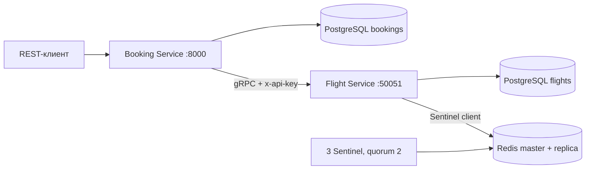

# Flight Booking

Домашнее задание №3: бронирование авиабилетов, gRPC и Redis.

Python 3.12, FastAPI, SQLAlchemy 2, PostgreSQL 17, Flyway, gRPC и Redis Sentinel.

## Запуск

Нужен Docker с Docker Compose. Из каталога проекта:

```bash
docker compose up --build -d --wait
docker compose logs flight-migrate booking-migrate flight booking
```

Swagger: http://localhost:8000/docs. REST-контракт: http://localhost:8000/openapi.json.

При сборке `protoc` генерирует Python-классы сообщений, клиент и интерфейс сервера из `proto/flights.proto`. Каталог `generated/` не хранится в Git. Отдельная команда генерации после установки `requirements.txt`: `make generate`.

Flyway автоматически создаёт структуру двух баз. Во Flight Service добавляются два рейса SVO → LED с датами через 7 и 8 дней после первого применения миграции. Дата конкретного рейса видна в ответе `/flights`. Данные PostgreSQL сохраняются в отдельных Docker volumes.

Параметры можно задать в `.env` или окружении. Значения по умолчанию предназначены для локального запуска. gRPC, PostgreSQL и Redis доступны только внутри сети Compose; наружу опубликован REST на `127.0.0.1:8000`.

| Переменная | По умолчанию | Назначение |
|---|---|---|
| `API_PORT` | `8000` | REST-порт |
| `GRPC_API_KEY` | `local-flight-service-key` | Общий ключ двух сервисов |
| `FLIGHT_DB_PASSWORD` | `local-flights` | Пароль базы рейсов |
| `BOOKING_DB_PASSWORD` | `local-bookings` | Пароль базы бронирований |
| `CACHE_TTL_SECONDS` | `600` | TTL кеша, от 300 до 600 секунд |
| `GRPC_MAX_ATTEMPTS` | `3` | Число попыток одного gRPC-вызова, от 1 до 3 |
| `GRPC_TIMEOUT_SECONDS` | `2` | Deadline каждой попытки |
| `GRPC_RETRY_BACKOFF` | `0.1` | Начальная задержка retry в секундах |
| `CB_FAILURE_THRESHOLD` | `5` | Порог последовательных транспортных ошибок |
| `CB_WINDOW_SECONDS` | `30` | Окно учёта ошибок |
| `CB_RESET_TIMEOUT` | `10` | Время до пробного запроса |
| `RECOVERY_INTERVAL_SECONDS` | `2` | Период восстановления незавершённых операций |

## Архитектура



Booking Service обращается только к своей базе и к gRPC Flight Service. Flight Service управляет рейсами, резервами и кешем. Прямых запросов из Booking Service в базу рейсов нет.

## REST

| Метод | Путь | Результат |
|---|---|---|
| GET | `/flights?origin=SVO&destination=LED&date=2027-01-10` | Рейсы `SCHEDULED`; дата необязательна |
| GET | `/flights/{id}` | Рейс по ID |
| POST | `/bookings` | Создание бронирования, HTTP 201 |
| GET | `/bookings/{id}` | Бронирование по ID |
| GET | `/bookings?user_id=UUID` | Бронирования пользователя |
| POST | `/bookings/{id}/cancel` | Отмена бронирования |

Пример создания:

```json
{
  "user_id": "aaaaaaaa-aaaa-4aaa-8aaa-aaaaaaaaaaaa",
  "flight_id": "11111111-1111-4111-8111-111111111111",
  "passenger_name": "Ivan Petrov",
  "passenger_email": "ivan@example.com",
  "seat_count": 2
}
```

ID имеют формат UUID. IATA-коды — три заглавные латинские буквы. Дата поиска трактуется как календарный день UTC. Даты рейса возвращаются в UTC. Цены передаются десятичными строками, например `"5000.00"`, чтобы не терять точность. Для демонстрационных рейсов используется одна валюта — рубли. Стоимость бронирования фиксируется при `GetFlight` и больше не зависит от текущей цены рейса.

`user_id` передаётся клиентом, как указано в задании. Проверка API key относится к межсервисным gRPC-вызовам.

Ошибки имеют поля `error_code`, `message` и, для валидации, `details`. Некорректные REST-данные возвращают 422, некорректная бизнес-команда — 400, отсутствующая запись — 404, недостаток мест или неверное состояние — 409. Недоступность Flight Service или открытый Circuit Breaker возвращают 503.

## gRPC

Контракт: `proto/flights.proto`, сервис `flights.v1.FlightService`.

| Метод | Поведение | Бизнес-ошибки |
|---|---|---|
| `SearchFlights` | Поиск по маршруту и необязательной дате | `INVALID_ARGUMENT` |
| `GetFlight` | Получение рейса | `INVALID_ARGUMENT`, `NOT_FOUND` |
| `ReserveSeats` | Атомарное резервирование по `booking_id` | `INVALID_ARGUMENT`, `NOT_FOUND`, `RESOURCE_EXHAUSTED`, `FAILED_PRECONDITION`, `ALREADY_EXISTS` |
| `ReleaseReservation` | Возврат мест по `booking_id` | `INVALID_ARGUMENT`, `NOT_FOUND` |
| `UpdateFlight` | Изменение цены, статуса или вместимости | `INVALID_ARGUMENT`, `NOT_FOUND`, `FAILED_PRECONDITION` |

`UpdateFlight` нужен для проверки инвалидации кеша при изменении рейса, упомянутой в пункте 7 задания. Маршрут, авиакомпания и расписание этой командой не меняются. Новая вместимость не может быть меньше уже зарезервированного количества мест.

Даты передаются через `google.protobuf.Timestamp`, статусы — через protobuf enum. `departure_date` в поиске должен указывать на 00:00:00 UTC; отсутствие поля означает поиск без ограничения даты.

Все методы проверяют metadata `x-api-key`; при отсутствии, неправильном или повторяющемся ключе возвращают `UNAUTHENTICATED`. Сбой базы возвращает `UNAVAILABLE`. Ключи задаются переменными окружения контейнеров.

## Транзакции и восстановление

`ReserveSeats` блокирует строку рейса через `SELECT FOR UPDATE`, проверяет статус и количество мест, уменьшает остаток и создаёт резервацию в одной транзакции. На `booking_id` установлен уникальный индекс. Advisory lock по `booking_id` сериализует повторные вызовы: одинаковые параметры возвращают существующий резерв, другие параметры дают `ALREADY_EXISTS`.

`ReleaseReservation` в одной транзакции возвращает места и переводит резерв в `RELEASED`. Повторный вызов возвращает тот же резерв и не увеличивает остаток второй раз. Возобновить освобождённый резерв нельзя.

Создание бронирования: `GetFlight` → запись операции восстановления → `ReserveSeats` → запись `CONFIRMED` и удаление операции восстановления в одной локальной транзакции. При ошибке бронирование не создаётся, а уже созданный резерв освобождается.

Две отдельные базы не образуют одну общую ACID-транзакцию. Для сбоя после удалённого commit используется журнал `booking_operations`. Фоновый обработчик возвращает места у не завершившихся созданий и доводит до конца начатые отмены. Если Flight Service недоступен, запись остаётся в журнале до восстановления связи. Поэтому после сетевого сбоя согласованность восстанавливается с задержкой; мгновенного отката в недоступном сервисе нет.

Во время запроса Booking Service удерживает advisory lock по ID бронирования. Восстановление использует `pg_try_advisory_xact_lock` и пропускает ещё выполняющиеся запросы. Отмена записывается в журнал до вызова Flight Service, поэтому её можно закончить после перезапуска Booking Service.

Если отмена пришла раньше задержавшегося резервирования, Flight Service сохраняет ID в `reservation_cancellations` и возвращает `NOT_FOUND`. Поздний `ReserveSeats` с таким ID получает `FAILED_PRECONDITION`. Это исключает создание забытого резерва после уже выполненной компенсации.

## Redis и отказоустойчивость

Cache-Aside используется для `flight:{id}` и `search:{origin}:{destination}:{date|all}`. TTL каждого значения — 600 секунд. В логах есть `cache_hit`, `cache_miss`, `cache_invalidated` и `cache_unavailable`.

После `ReserveSeats`, `ReleaseReservation` и `UpdateFlight` удаляются ключ рейса и результаты поиска по его маршруту с датой и без даты. Для защиты от конкурентного заполнения кеша и потери инвалидации при сбое Redis в PostgreSQL хранится `cache_epoch`. Мутация увеличивает версию в той же транзакции, что и бизнес-данные. Кешированные значения содержат эту версию.

На чтении выполняется короткий запрос версии в PostgreSQL, затем проверяется кеш. Значение с другой версией игнорируется и перезаписывается. Запоздавший ответ, старое значение на реплике и неудавшийся `DEL` не приводят к выдаче устаревших данных после завершённой мутации. Версия общая: изменение одного рейса консервативно сбрасывает пригодность всего кеша. Это упрощает согласованность, но уменьшает эффективность кеша при частых изменениях. Просроченные версии удаляются по TTL.

При недоступном Redis данные читаются из PostgreSQL. Redis содержит только кеш. Sentinel-конфигурация состоит из мастера, реплики и трёх Sentinel с кворумом 2. Клиент использует `redis.sentinel.Sentinel.master_for()` и узнаёт новый адрес мастера после переключения.

При старте реплика и Sentinel разрешают имя `redis-master` в IP и сохраняют его в настройках. Повторные DNS-запросы к остановленному контейнеру не блокируют обнаружение отказа и выбор нового мастера.

Retry и Circuit Breaker находятся в клиентском gRPC interceptor, отдельно от бизнес-логики:

- Максимум три попытки, задержки перед повторениями — 100 и 200 мс.
- Повторяются только `UNAVAILABLE` и `DEADLINE_EXCEEDED`.
- Встроенные gRPC retry отключены, чтобы не превысить лимит попыток.
- Circuit Breaker считает транспортные ошибки завершённых логических вызовов. Успешный вызов или бизнес-ошибка сбрасывает последовательность отказов.
- После пяти ошибок за 30 секунд состояние меняется с `CLOSED` на `OPEN`.
- В `OPEN` реальный RPC не выполняется, REST получает 503.
- Через 10 секунд допускается один пробный RPC в `HALF_OPEN`, без retry. Остальные запросы сразу отклоняются.
- Успешный пробный вызов закрывает цепь; транспортная ошибка снова открывает её. Переходы видны в JSON-логах.

## Схема данных

ER-диаграмма и обоснование 3NF: [docs/schema.md](docs/schema.md).

Миграции: `migrations/flight/` и `migrations/booking/`. Внешние ключи действуют внутри одной базы. `booking_id` и `flight_id` между сервисами — логические ссылки без межбазовых FK.

## Проверка

```bash
make demo
make test
make test-down
```

`make test` использует отдельный Compose-проект `flight-booking-tests`, отдельные базы и volumes. Основной REST-порт не занимается. Для `compose.test.yaml` нужен Docker Compose 2.24.4 или новее. Тестовые базы очищаются между тестами. `make test-down` удаляет только тестовые контейнеры и данные.

Проверяются REST и настоящий gRPC, поиск с датой и без неё, API key для всех методов, снимок цены, ограничения PostgreSQL, гонка за последнее место, идемпотентность, rollback при ошибке записи, восстановление после сбоя, TTL и инвалидирование кеша, retry и три состояния Circuit Breaker.

Проверено 4 ноября 2026 года в Docker на Linux:

- 73 теста прошли с настоящими PostgreSQL, gRPC и Redis.
- `make demo` выполнил создание, чтение и отмену бронирования, а также отрицательные сценарии.
- При остановке Redis-мастера Sentinel автоматически назначил реплику новым мастером; кеш снова заполнился с TTL.
- При остановке обоих Redis чтение, создание и отмена бронирования продолжили работать через PostgreSQL.
- При остановке Flight Service Circuit Breaker открылся; запрос в `OPEN` вернул 503 примерно за 2 мс. После запуска сервиса прошли переходы `OPEN → HALF_OPEN → CLOSED`.
- SQL-запросы подтвердили возврат мест, статусы `CANCELLED`/`RELEASED` и пустой журнал незавершённых операций.

### Демонстрация данных в PostgreSQL

```bash
docker compose exec booking-db psql -U bookings -d bookings -c 'SELECT id, flight_id, seat_count, total_price, status FROM bookings;'
docker compose exec flight-db psql -U flights -d flights -c 'SELECT id, flight_number, total_seats, available_seats, price, status FROM flights;'
docker compose exec flight-db psql -U flights -d flights -c 'SELECT booking_id, flight_id, seat_count, status FROM seat_reservations;'
docker compose exec booking-db psql -U bookings -d bookings -c 'SELECT * FROM booking_operations;'
```

### Кеш

```bash
curl 'http://localhost:8000/flights?origin=SVO&destination=LED'
curl 'http://localhost:8000/flights?origin=SVO&destination=LED'
docker compose logs flight
docker compose exec redis-master redis-cli TTL search:SVO:LED:all
```

Первый запрос заполняет кеш, второй даёт `cache_hit`. После переключения Redis роль мастера следует уточнить через Sentinel.

### Переключение Redis

```bash
docker compose exec sentinel-1 redis-cli -p 26379 SENTINEL get-master-addr-by-name flights
docker compose stop redis-master
docker compose logs -f sentinel-1
```

После сообщения `+switch-master` завершить просмотр логов через Ctrl+C:

```bash
docker compose exec sentinel-1 redis-cli -p 26379 SENTINEL get-master-addr-by-name flights
curl 'http://localhost:8000/flights?origin=SVO&destination=LED'
docker compose logs flight
docker compose start redis-master
```

Временное отсутствие кеша не мешает чтению из PostgreSQL. После обнаружения нового мастера кеш снова заполняется.

### Circuit Breaker

```bash
docker compose stop flight
for i in 1 2 3 4 5 6; do curl -s -w '\n%{http_code} %{time_total}s\n' 'http://localhost:8000/flights?origin=SVO&destination=LED'; done
docker compose logs booking
docker compose start flight
```

В логах появится `CLOSED → OPEN`, а шестой запрос получит быстрый 503. После `CB_RESET_TIMEOUT` следующий запрос проверит восстановленный Flight Service; в логах будут `OPEN → HALF_OPEN → CLOSED`.

Остановить проект с сохранением данных: `make down`.

## Где смотреть код

- `proto/flights.proto` — gRPC-контракт.
- `flight/service.py` — поиск, транзакции резервирования и возврата мест.
- `flight/auth.py` — проверка API key.
- `flight/cache.py` — Cache-Aside и Sentinel-клиент.
- `booking/main.py` — REST-контроллеры и ошибки.
- `booking/service.py` — создание, отмена и восстановление бронирований.
- `booking/resilience.py` — retry и Circuit Breaker.
- `tests/` — интеграционные проверки и проверки отказов.

Документация: [gRPC Python](https://grpc.io/docs/languages/python/quickstart/), [gRPC deadlines](https://grpc.io/docs/guides/deadlines/), [Redis Sentinel](https://redis.io/docs/latest/operate/oss_and_stack/management/sentinel/), [транзакции SQLAlchemy](https://docs.sqlalchemy.org/en/20/core/connections.html#using-transactions).
