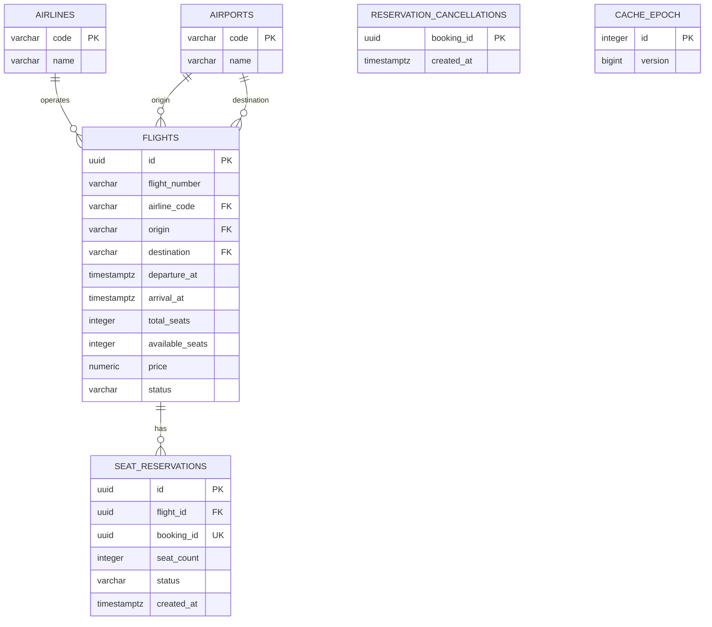
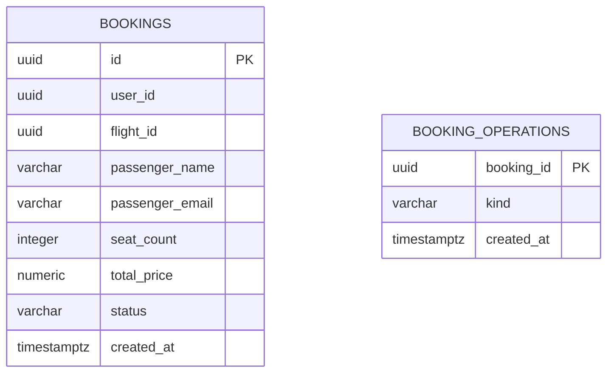

# Схема данных

## Flight Service

## Booking Service

`SEAT_RESERVATIONS.booking_id` ссылается на `BOOKINGS.id` логически: базы находятся в разных сервисах, физического FK между ними нет. Для каждого успешно подтверждённого бронирования создаётся одна резервация. Уникальность `booking_id` исключает второй резерв. Освобождённые резервации не удаляются: они обеспечивают идемпотентность повторной отмены.

`BOOKINGS.flight_id` — логическая ссылка на `FLIGHTS.id`. `user_id` — внешний идентификатор пользователя. Пассажирские данные относятся к конкретному бронированию: пользователь может оформить разные бронирования для разных пассажиров.

## 3NF

Поля атомарны. В каждой таблице есть первичный ключ, а неключевые поля зависят от идентификатора своей сущности. Названия аэропортов и авиакомпаний вынесены в справочники и не дублируются в рейсах. Booking Service хранит ID рейса, а не копии его маршрута, названия авиакомпании и расписания.

`total_price` — историческая стоимость конкретного бронирования. Она не зависит от будущих изменений `FLIGHTS.price`. `available_seats` — требуемый заданием счётчик остатков, согласованность которого с резервами поддерживается одной транзакцией.

Номер рейса вместе с календарной датой вылета UTC уникален. Для этого создан уникальный индекс по выражению, без отдельного дублирующего поля даты.

`BOOKING_OPERATIONS` — журнал восстановления до появления бронирования или завершения отмены. `RESERVATION_CANCELLATIONS` блокирует опоздавшее резервирование после компенсации. `CACHE_EPOCH` — одна служебная строка для версии кеша. Эти таблицы не хранят копии бизнес-данных.

## Ограничения

- `total_seats > 0`, `0 <= available_seats <= total_seats`, `seat_count > 0`.
- `price > 0`, `total_price > 0`.
- Аэропорты вылета и прилёта различаются, время прилёта позже вылета.
- Аэропорты имеют IATA-коды из трёх заглавных латинских букв.
- Статусы проверяются ограничениями `CHECK` в PostgreSQL и enum в gRPC-контракте.
- Связи внутри Flight Service защищены внешними ключами.
- `seat_reservations.booking_id` уникален.
- Поиск рейсов и бронирования пользователя поддержаны индексами.
